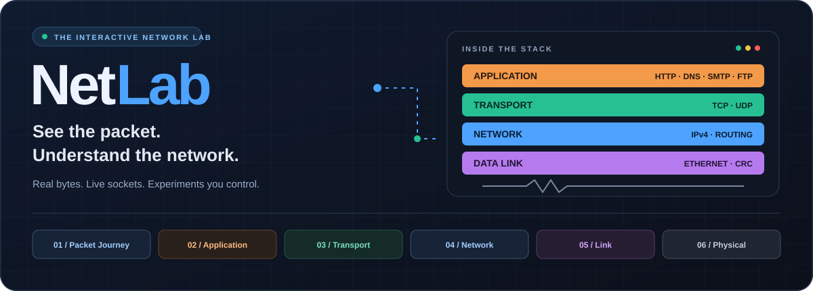
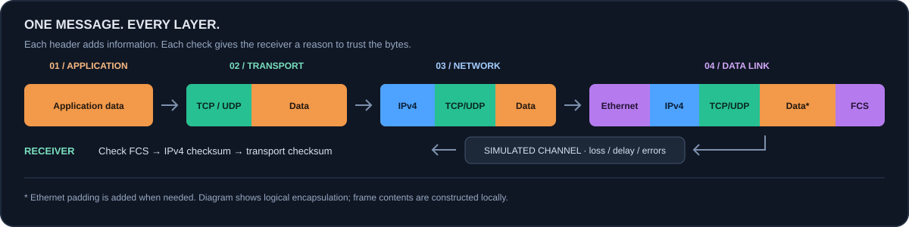

<div align="center">



**An interactive desktop playground for Data Communication & Networking.**

Build packets, break links, trace routes, and watch signals take shape.


[Get started](#-get-started) · [Explore the labs](#-six-labs-one-network) · [How it works](#-follow-the-packet) · [Demo guide](DEMO.md)

<sub>316U04C304 · Data Communication and Networking · SY B.Tech IT · KJSSE</sub>

</div>

---

## ✨ Networking you can inspect

NetLab connects the theory to the bytes. Follow an application message down the protocol stack, inspect its headers in a linked field table and hex view, then see exactly which layer rejects it when something goes wrong.

| 🧩 Build it | 🔍 Inspect it | ⚡ Break it |
| :--- | :--- | :--- |
| Construct Ethernet, IPv4, TCP, and UDP headers with computed checksums. | Select a field to highlight its bytes, or select bytes to find their field. | Introduce bit errors, packet loss, and delay in a controlled channel. |
| 🌐 **Connect it** | 📈 **Visualize it** | 📦 **Export it** |
| Send real DNS queries, raw HTTP requests, and local TCP/UDP chat messages. | Explore routing, retransmissions, congestion windows, and signal waveforms. | Save constructed frames as `.pcap` files for inspection in Wireshark. |

## 🚀 Get started

Use **Python 3.14** to match the project's development environment. Dependencies are pinned in [requirements.txt](requirements.txt); the GUI needs a desktop environment.

### Windows · PowerShell

```powershell
git clone https://github.com/HarshadS7/Netlab-DCN-Mini-Project.git
cd Netlab-DCN-Mini-Project

py -3.14 -m venv .venv
.\.venv\Scripts\python.exe -m pip install -r requirements.txt
.\.venv\Scripts\python.exe main.py
```

### macOS / Linux · shell

```bash
git clone https://github.com/HarshadS7/Netlab-DCN-Mini-Project.git
cd Netlab-DCN-Mini-Project

python3.14 -m venv .venv
.venv/bin/python -m pip install -r requirements.txt
.venv/bin/python main.py
```

Already have the source? Open a terminal in the project folder and start at the virtual environment step. These commands use the environment's Python directly, so activation is optional.

> 💡 **First experiment:** open **Packet Journey**, keep the default HTTP settings, and press **Send**. Select a header field, inspect the highlighted bytes, then increase **Bit error rate** and send again.

## 🧪 Six labs, one network

| Lab | Explore | Syllabus | Outcome |
| :--- | :--- | :---: | :---: |
| 🟠 **Packet Journey** | Encapsulation and decapsulation, linked byte inspection, channel errors, and PCAP export. | 1–5 | CO1, CO2 |
| 🟠 **Application Lab** | DNS over real UDP, HTTP/1.1 over real TCP, and a loopback TCP/UDP chat. | 2 | CO2 |
| 🟢 **Transport Lab** | Three-way handshake, four-way close, sliding windows, and TCP Reno congestion control. | 3 | CO2 |
| 🔵 **Network Lab** | CIDR subnetting, VLSM, Dijkstra, distance vector, longest-prefix forwarding, and IPv4 vs IPv6. | 4 | CO3 |
| 🟣 **Link Lab** | Hamming codes, CRC division, Internet checksum, byte/bit stuffing, and ARQ timelines. | 5.1–5.2 | CO4 |
| ⚪ **Physical Lab** | Seven line codes, ASK/FSK/PSK/QPSK, PCM and aliasing, multiplexing, and Nyquist/Shannon limits. | 5.3–5.4 | CO4 |

<details>
<summary><strong>🔬 Look inside the experiments</strong></summary>

- **Error control:** flip a Hamming codeword bit and inspect the syndrome; follow each XOR in polynomial CRC division.
- **Reliable delivery:** compare Stop-and-Wait, Go-Back-N, and Selective Repeat against the same losses.
- **Routing:** step through shortest paths, break a link, and compare count-to-infinity with split horizon enabled.
- **Transport:** follow TCP state transitions and see how a timeout or duplicate acknowledgements affect the congestion window.
- **Signals:** compare NRZ-L, NRZ-I, Manchester, differential Manchester, AMI, B8ZS, and HDB3; inspect modulation constellations.
- **Sampling:** lower the PCM sampling rate to expose aliasing, then compare bandwidth and signal-to-noise limits.

</details>

## 🌈 Follow the packet



The Packet Journey engine constructs **HTTP, DNS, SMTP, or FTP** application data, wraps it in **TCP or UDP**, adds **IPv4** and **Ethernet**, and computes the checksums required by each layer. The receiver checks the Ethernet FCS, IPv4 header checksum, and transport checksum in order.

The same layer colours appear across the animation, field table, and hex view, so a header stays recognizable as you move between views.

### Real bytes, real sockets, controlled simulations

| Implemented with real bytes / sockets | Modelled for experimentation |
| :--- | :--- |
| Packed protocol headers and computed checksums. | Packet Journey's channel, including bit errors, loss, and delay. |
| TCP/UDP checksums covering the IPv4 pseudo-header. | Routing convergence and link failures. |
| IEEE CRC-32 Ethernet FCS and minimum-frame padding. | TCP state, sliding-window, congestion-control, and ARQ demonstrations. |
| DNS queries over UDP and HTTP/1.1 requests over TCP. | Line coding, modulation, sampling, and multiplexing waveforms. |
| Loopback chat using `QTcpServer` and `QUdpSocket`. | Application-controlled message dropping in the UDP chat demo. |

> 🧠 **Why “Corrupt inside a router” matters:** Ethernet's FCS protects a single link. The demo can corrupt frame contents and recompute the FCS to model damage before a new frame leaves a router. The link check then passes, while the IPv4 header checksum or transport checksum can expose the damage. The IPv4 checksum covers only the IP header; TCP/UDP also cover the transport data and pseudo-header.

<details>
<summary><strong>🟣 Why are there two CRC implementations?</strong></summary>

Both live in [netlab/core/errors/crc.py](netlab/core/errors/crc.py), with different purposes:

- **`crc_remainder`** performs textbook polynomial long division and records the XOR steps for the Link Lab.
- **`crc32_ieee`** computes the reflected IEEE CRC-32 used for Ethernet's frame check sequence.

The textbook calculation and Ethernet FCS use different conventions. NetLab keeps them separate so the teaching trace and constructed frames each use the appropriate algorithm.

</details>

## 🎬 A demo worth trying

1. **Send a packet.** Follow its headers down the stack in Packet Journey.
2. **Flip the outcome.** Increase the bit error rate and inspect the receiving layer's verdict.
3. **Compare retransmissions.** Lose a frame in Link Lab, then switch between Go-Back-N and Selective Repeat.
4. **Break a route.** Step through distance-vector updates and try split horizon.
5. **Inspect the signal.** Pick a long run of zeros and compare AMI, B8ZS, and HDB3.
6. **Take the bytes with you.** Export a frame and open it in Wireshark.

For a rehearsable walkthrough with talking points and viva questions, see the **[10-minute demo guide](DEMO.md)**.

### Demo without external internet

- **DNS:** select **Offline stub**. A local DNS server answers canned records over real loopback sockets.
- **Chat:** the server binds to `127.0.0.1`, so both ends run on the same machine.
- **HTTP:** requires access to the selected remote server; skip it when offline.
- **Other labs:** packet construction, routing, error control, transport simulations, and signal experiments run locally.

## ✅ Verify the engine

```powershell
# Windows
.\.venv\Scripts\python.exe -m pytest tests/ -q
```

```bash
# macOS / Linux
.venv/bin/python -m pytest tests/ -q
```

The test suite covers the pure-Python engine without importing Qt. It includes known checksum vectors, error detection and correction, routing, addressing, transport behaviour, signal calculations, PCAP structure, and the local DNS stub.

| Check | Expected result |
| :--- | :--- |
| IEEE CRC-32 of `123456789` | `0xCBF43926` |
| Canonical IPv4 header checksum vector | `0xB861` |
| `192.168.1.0/24` split into four subnets | Four `/26` blocks, each with 62 usable hosts |
| Single-bit Hamming errors | Corrected across the tested data lengths |
| Dijkstra vs distance vector | Both agree with the hand-computed test topology |

**Inspect captures independently:** use **Export .pcap** in Packet Journey, open the file in Wireshark, and inspect the decoded layers. Enable the relevant checksum validation settings when checking checksums. The exporter strips the four-byte Ethernet FCS by default, as is common in packet captures; NetLab still constructs and verifies it internally. Wireshark inspection is a manual check, separate from the automated tests.

## 🗂️ Project map

```text
Netlab-DCN-Mini-Project/
├── main.py                    Desktop application entry point
├── requirements.txt           Pinned Python dependencies
├── DEMO.md                    Walkthrough and viva talking points
├── docs/assets/               README artwork
├── netlab/
│   ├── core/                  Protocol engine; no Qt imports
│   │   ├── stack.py           Encapsulation and receiver checks
│   │   ├── channel.py         Loss, corruption, and delay
│   │   ├── pcap.py            Capture-file export
│   │   ├── transport_sim.py   TCP states, windows, and Reno
│   │   ├── layers/            Application, transport, network, data link
│   │   ├── errors/            Checksum, CRC, and Hamming
│   │   ├── arq/               Stop-and-Wait, Go-Back-N, Selective Repeat
│   │   ├── routing/           Addressing and routing algorithms
│   │   ├── signals/           Coding, modulation, PCM, and rate limits
│   │   └── live/              DNS, HTTP, and local DNS stub
│   └── ui/                    PySide6 interface
│       ├── pages/             The six lab pages
│       ├── widgets/           Hex view, bit grid, timelines, topologies
│       └── theme.py           Dark palette and shared layer colours
└── tests/                     Core and lab tests
```

The engine and interface stay separate: `netlab/core/` handles the networking logic, while `netlab/ui/` presents the experiments using **PySide6**, **pyqtgraph**, and **NumPy**.

---

<div align="center">

**Build a packet. Follow every byte. See why it works.**

[Back to top ↑](#)

</div>
